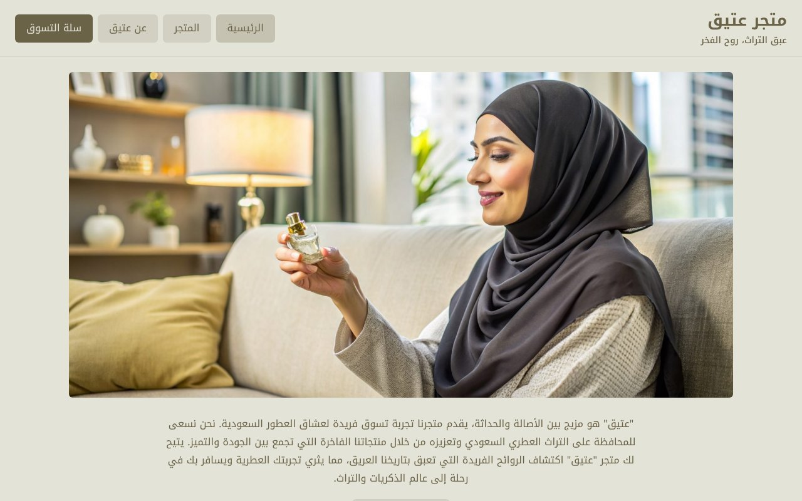
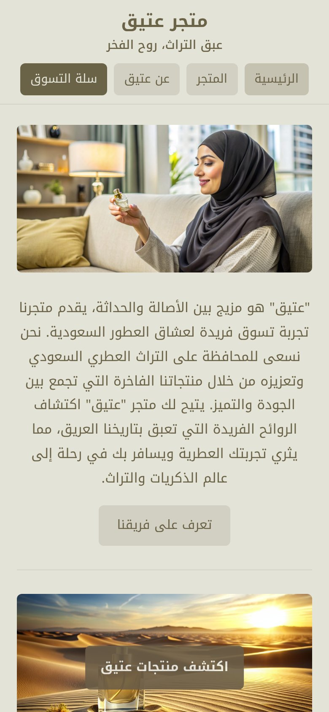

# Ateeq — Saudi Perfume Store (concept)

**Live site:** https://irbala.github.io/ateeq/

  
  

Click a screenshot to open the live site.

Ateeq is a concept store for a Saudi perfume brand, built as a front-end project. It is a design and code demo: there is no real payment or ordering, and "checkout" simply empties the cart and shows a thank-you message.

## Pages

| Page | What's on it |
|---|---|
| `index.html` | Cover photo, brand introduction and a link to the shop |
| `shop.html` | The three perfumes, each with an "add to cart" button |
| `cart.html` | The cart: change quantities, remove items, see the total, check out |
| `about.html` | Brand story, team and visual identity board |

## Features

- Arabic, right-to-left layout
- Shopping cart saved in the browser (`localStorage`), so it survives moving between pages
- Change quantities or remove items in the cart, with a live total
- Item count shown next to the cart link on every page
- Header that stays in view while scrolling on desktop
- Responsive: three products per row on desktop, two on tablets, one on phones

## Tech

HTML, CSS and plain JavaScript. No frameworks or build step.

- `styles.css` holds all the styles, with the brand colours as variables at the top
- `script.js` holds the cart logic

## Design Decisions

- **Sand and olive.** A beige background (`#E4E3D8`) with olive-brown text gives an earthy, heritage feel that matches the brand line "عبق التراث، روح الفخر". <!-- guess: Fay, please confirm or edit -->
- **Kufi type.** Noto Kufi Arabic, a geometric Kufi style, nods to traditional Arabic lettering while staying clean on screen. <!-- guess: Fay, please confirm or edit -->
- **Perfumes named after places.** Taif rose, Riyadh oud and Jazan fruit tie each scent to a Saudi region, which the product photos carry through.
- **RTL details.** Pages are `lang="ar" dir="rtl"`. The phone number is wrapped in `dir="ltr"` so its digits stay in order, and the cart count uses `margin-inline-start` so its spacing follows the text direction.
- **A real cart without a backend.** The cart is saved in `localStorage`, so it survives moving between pages, and the count next to the cart link updates on every page. Checkout is a demo that empties the cart and says thank you.
- **Sticky header on desktop** so the cart is always one click away while browsing.

## Accessibility

Checked on 19 November 2026 with [axe-core](https://github.com/dequelabs/axe-core) 4.10, the engine behind Lighthouse's accessibility score, against WCAG 2.1 A and AA plus axe's best-practice rules. Every page was tested in a desktop browser.

| Page | Issues | Rules passed |
|---|---|---|
| `about.html` | ✅ 0 issues | 32 |
| `cart.html` | ✅ 0 issues | 31 |
| `index.html` | ✅ 0 issues | 32 |
| `shop.html` | ✅ 0 issues | 33 |

## Run it locally

Download or clone the repo and open `index.html` in a browser.
